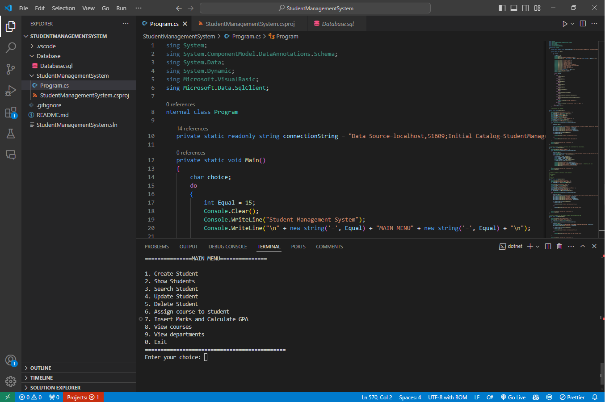
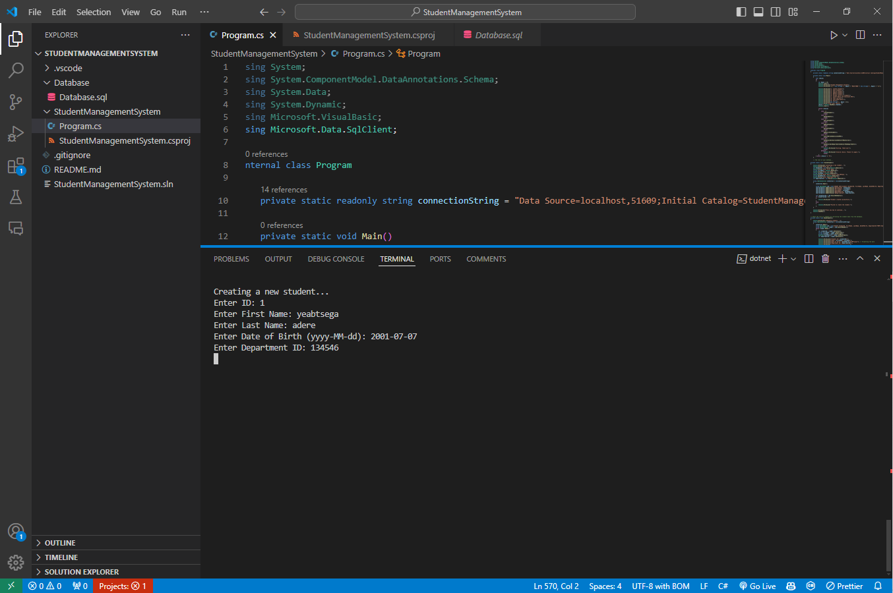

<<<<<<< HEAD
<h1 align="center">Student Management System</h1>
<h4 align="center">A simple console based DBMS project to handle <strong>CRUD</strong> operations.</h4>


## About

This is a console-based Student Management System, which is a simple application designed to manage student records, including creating, updating, and deleting student information. Additionally, it allows for the assignment of courses to students, inserting student marks, calculating GPA, and viewing available courses and departments.

### Key functionalities of this Student Management System include:

1. **Create Student**: Users can input a student's ID, first name, last name, date of birth, and department ID to create a new student record in the database.

2. **Show Students**: This function retrieves and displays a list of all students stored in the database, including their basic information like name, date of birth, and department ID.

3. **Update Student**: Users can update the information of an existing student by providing their ID and modifying their first name, last name, date of birth, and department ID.

4. **Delete Student**: Allows the removal of a student record by specifying the student's ID.

5. **Add Course to Student**: This feature allows users to assign courses to students by selecting a student's ID and a course ID from a list of available courses.

6. **Insert Marks and Calculate GPA**: Users can enter marks for a student in a specific course, and the system will automatically calculate the GPA based on the provided marks.

7. **Search Student**: This function allows users to search for a specific student by their ID and displays detailed information about the student, including the courses they are enrolled in and their corresponding grades.

8. **View Courses and Departments**: Users can view a list of available courses and departments, and they can also insert new courses and departments.

The code interacts with a SQL Server database using SQL commands for data retrieval, insertion, updating, and deletion. It includes error handling to provide feedback on the success or failure of database operations.

Overall, this Student Management System serves as a basic tool for managing student information and academic records, making it useful for educational institutions or organizations that require a straightforward means of handling student data. Further improvements could include enhanced user interface features and additional functionalities like grade reporting, student enrollment management, and data analytics.





## Dependencies

- C#
- .NET SDK (7.0.403)
- Microsoft SQL Server (SQL Express 2022)
- Microsoft Data.SqlClient (5.1.2)


## How to use

1. Clone the repository
2. Create Database _or_ Import Database from backup
3. Open the project in Visual Studio Code
4. Install C# Dev Kit
5. Run the project

>[!Note]
>You can also use Visual Studio _or_ your favorite IDE to run this project.

## Error Handling

- Be patient. Wait for all packages to be restored.  
  All packages will be restored in the project root folder.
- **Microsoft.Data.SqlClient** _error_  
  If packages are not restored automatically, then run `dotnet restore` _or_
  Download the `Microsoft.Data.SqlClient` package from `https://www.nuget.org/packages/Microsoft.Data.SqlClient` _or_ from the `terminal`, run `dotnet add package Microsoft.Data.SqlClient`.
- **SQL Server** _error_
  - Check your SQL Server connection.
  - Configure your SQL Server connection.
    ```text
    localhost ip-----OR----enable any existing ip from SQL
    Server (2022) Configuration manager\SQL Server Network
    Configuration\protocols For SQLEXPRESS(instance name)\
    TCP/IP\properties\protocol(enabled)\IP Address
    ```
    ```text
    port = "51609"; // The port, configured in SQL Server Configuration Manager
    ```
    _OR_
    Change `connectionString` in `Program.cs` file.  

    ```cs
    // connectionString = "Data Source=InstanceName;Initial Catalog=StudentManagementSystem;Integrated Security=True;Encrypt=False";
    
    // Database connection string
    static string connectionString = "Data Source=localhost,51609;Initial Catalog=StudentManagementSystem;Integrated Security=True;Encrypt=False";
    ```
=======
# Student Management System

A console-based Student Management System built with **C#**, **.NET** and **Microsoft SQL Server** using **ADO.NET**. It manages students, departments, courses and enrollments, and calculates grade points from marks.

## Features

- **Students:** create, view, search, update and delete student records
- **Departments:** view all departments and add new ones
- **Courses:** view all courses and add new ones
- **Enrollment:** assign courses to students, with checks that the student and course exist
- **Marks & Grade Points:** enter marks for a course and convert them to a 4.0-scale grade point
- **Search:** view a student's enrolled courses and grades
- **Security:** all queries use parameterized SQL to prevent SQL injection

## Tech Stack

| Layer        | Technology                        |
|--------------|-----------------------------------|
| Language     | C#                                |
| Framework    | .NET                              |
| Data Access  | ADO.NET (`Microsoft.Data.SqlClient`) |
| Database     | Microsoft SQL Server (SSMS)       |
| IDE          | Visual Studio / VS Code           |

## 🗄️ Database Schema

```
Department (DepartmentID PK, DepartmentName)
     │ 1
     │
     ├──────────< Student (StudentID PK, FirstName, LastName, DateOfBirth, DepartmentID FK)
     │                │ 1
     │                │
     └──────────< Course (CourseID PK, CourseName, DepartmentID FK)
                      │ 1        │
                      │          │
                      └────< Enrollment >────┘
                   (EnrollmentID PK, StudentID FK, CourseID FK, Grade)
```

- A department has many students and offers many courses.
- Students and courses have a many-to-many relationship through `Enrollment`.

## Grade Point Scale

| Marks   | Grade Point |
|---------|-------------|
| 80+     | 4.0         |
| 70–79   | 3.5         |
| 60–69   | 3.0         |
| 50–59   | 2.5         |
| 40–49   | 2.0         |
| < 40    | 0.0         |

## Getting Started

### Prerequisites

- [.NET SDK](https://dotnet.microsoft.com/download) (6.0 or later)
- Microsoft SQL Server and SQL Server Management Studio (SSMS)

### 1. Clone the repository

```bash
git clone https://github.com/rehmnjr/StudentManagementSystem.git
cd StudentManagementSystem
```

### 2. Create the database

Open SSMS and run the SQL script:

```sql
CREATE DATABASE StudentManagementSystem;
GO
USE StudentManagementSystem;
GO

CREATE TABLE Department (
    DepartmentID INT PRIMARY KEY,
    DepartmentName VARCHAR(255)
);

CREATE TABLE Student (
    StudentID INT PRIMARY KEY,
    FirstName VARCHAR(255),
    LastName VARCHAR(255),
    DateOfBirth DATE,
    DepartmentID INT FOREIGN KEY REFERENCES Department(DepartmentID)
);

CREATE TABLE Course (
    CourseID INT PRIMARY KEY,
    CourseName VARCHAR(255),
    DepartmentID INT FOREIGN KEY REFERENCES Department(DepartmentID)
);

CREATE TABLE Enrollment (
    EnrollmentID INT IDENTITY(1,1) PRIMARY KEY,
    StudentID INT FOREIGN KEY REFERENCES Student(StudentID),
    CourseID INT FOREIGN KEY REFERENCES Course(CourseID),
    Grade DECIMAL(4, 2)
);
```

### 3. Update the connection string

In `Program.cs`, set the connection string to match your SQL Server instance:

```csharp
private static readonly string connectionString =
    "Data Source=localhost;Initial Catalog=StudentManagementSystem;Integrated Security=True;Encrypt=False";
```

### 4. Run the app

```bash
dotnet add package Microsoft.Data.SqlClient
dotnet run
```

##  Usage

```
Student Management System

===============MAIN MENU===============

1. Create Student
2. Show Students
3. Search Student
4. Update Student
5. Delete Student
6. Assign course to student
7. Insert Marks and Calculate GPA
8. View courses
9. View departments
0. Exit
=============================================
Enter your choice:
```

> **Tip:** Add departments first, then courses and students, then enroll students in courses before entering marks.

## Future Improvements

- Convert to an **ASP.NET Core Web API** with a **React.js** frontend
- Store raw marks and grade points separately and calculate overall GPA per student
- Add a `CourseDepartment` table so a course can be offered by multiple departments
- Add input validation, exception handling and unique enrollment constraints
- Move the connection string to `appsettings.json`

## Author

**Fahim Rehman**
- GitHub: [@rehmnjr](https://github.com/rehmnjr)
- LinkedIn: [fahimrehman](https://linkedin.com/in/fahimrehman)
- Email: rehmnfahim@gmail.com
>>>>>>> c87ed3fa6aed449afa208462d1d6c28cd507a755
